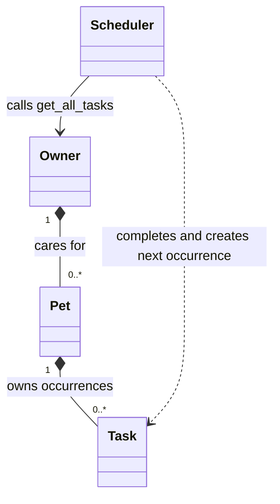

# 🐾 PawPal+

PawPal+ helps a busy owner organize care for multiple pets: feeding, walks, medication, enrichment, and appointments. A Python domain model powers both a readable CLI demo and an interactive Streamlit dashboard. No AI API key or external service is needed to run the app.

Built from [CodePath's PawPal+ starter](https://github.com/codepath/ai110-module2show-pawpal-starter) for [AI110, Week 5](https://courses.codepath.org/courses/ai110/unit/5#!projects).

## Features

- Add an owner and multiple pets, including species and optional breed.
- Add and edit dated tasks with a duration, priority, and once/daily/weekly frequency.
- View the household's schedule chronologically; combine pet, date, and completion filters.
- See warnings when pending tasks share the same date and start time, including tasks for different pets.
- Complete a recurring task to create its next occurrence, keeping the completed history.
- Generate a daily plan that favors higher priorities, respects a total care-time budget, and avoids overlapping task durations. Skipped tasks have explicit explanations and remain pending.
- Explore a sample household with two pets and five tasks using **Load example household**.

## Setup and run

Use Python 3.12 (the verified version). From the project directory:

```bash
python3 -m venv .venv
source .venv/bin/activate
python -m pip install -r requirements.txt

# Terminal demo, using today's date:
python main.py

# Reproduce the output below:
python main.py --date 2026-10-14

# Interactive UI:
python -m streamlit run app.py

# Tests:
python -m pytest
```

On Windows PowerShell, activate with `.\.venv\Scripts\Activate.ps1`. Open the local URL printed by Streamlit, normally `http://localhost:8501`.

The UI stores its `Owner` in `st.session_state`, preserving pets and tasks across widget interactions and reruns. A browser reload, new session, or app restart resets the data. There is no disk persistence or account system.

## Implementation summary

| Class | Responsibility |
| --- | --- |
| `Task` | Dataclass containing description, `HH:MM` time, due date, frequency, completion status, duration, priority, and stable identity. `mark_complete()` changes one occurrence's status. |
| `Pet` | Dataclass containing identifying information and tasks. `add_task()`, `list_tasks()`, and `update_task()` manage that pet's activities. |
| `Owner` | Dataclass managing multiple pets. `get_all_tasks()` aggregates tasks across **all** pets; `get_pet()` resolves task ownership. |
| `Scheduler` | Retrieves current tasks through `Owner.get_all_tasks()` and handles sorting, filtering, completion with recurrence, warnings, and planning. |

`app.py` imports the backend classes and calls their methods when forms are submitted. It contains display and session management, while `pawpal_system.py` has no Streamlit dependency. `main.py` demonstrates the same backend without a browser.

The original design is in [diagrams/uml_draft.mmd](diagrams/uml_draft.mmd). The final Mermaid source is [diagrams/uml_final.mmd](diagrams/uml_final.mmd); `diagrams/uml.mmd` contains the same final diagram for compatibility with the starter layout.



## Smarter Scheduling

| Feature | Method | Behavior |
| --- | --- | --- |
| Chronological ordering | `Scheduler.sort_by_time()` | Stable sort by due date, then validated zero-padded time; does not mutate the stored list. O(n log n). |
| Combined filters | `Scheduler.filter_tasks()` | Filter by case-insensitive pet name, completion status, and/or exact date, then return chronological results. |
| Conflict warnings | `Scheduler.detect_conflicts()` | Group pending tasks by `(due_date, time)` and return one warning per shared slot across all pets. Completed tasks do not conflict. |
| Recurrence | `Scheduler.mark_task_complete()` | Mark once; for daily/weekly tasks append a new task with a fresh ID, the same pet and care details, and an incomplete status. Repeated completion does not duplicate it. |
| Priority ranking | `Scheduler.sort_by_priority()` | High → medium → low, then date and time. |
| Budget and overlap planning | `Scheduler.build_plan()` | Greedily select pending tasks for a chosen date in priority order, within the total minute budget and without overlapping selected intervals; return selected tasks chronologically plus reasons for skipped tasks. |

For recurrence, the next date is `max(original_due_date, completion_date) + 1 day` for daily tasks or `+ 7 days` for weekly tasks. This schedules an overdue task after completion rather than creating overdue backlog, and prevents early completion from moving a future recurrence backwards. Date arithmetic handles month/year boundaries. Use the scheduler's completion method in integrations; `Task.mark_complete()` alone only changes status.

The base conflict warning detects **exact start-time matches**. The plan builder additionally checks overlapping durations, allowing tasks that meet exactly at their boundaries. It keeps entered times rather than moving tasks. Planning is greedy, not a global optimization; its overlap checks take O(n²) in the worst case. It only considers tasks starting on the requested day, so cross-day overlaps are outside its scope. Priorities are owner-assigned, not medical recommendations.

## Demo Walkthrough

1. Start Streamlit and enter an owner name in the sidebar. Add **Mochi** (dog) and **Luna** (cat), or click **Load example household** on an empty session.
2. Open **＋ Schedule a task**. Choose a pet, enter a description, date, time, duration, frequency, and priority, then click **Add task**.
3. View **Your schedule**. Tasks appear in date/time order even when entered out of order. Filter by pet or status, pick a date, or enable **All dates** to view future recurring occurrences.
4. Give two pending tasks the same date and time. The warning names both pets and activities; use **Manage a task · edit or complete** to change a task's time.
5. Select a daily task under **Manage a task**, then click **Mark complete**. The success message gives its next due date; the completed occurrence remains available under **Completed** or **All** status.
6. Open **Build a daily plan**, set the care-time budget, and click **Generate schedule**. The plan considers every pet regardless of the display filter. Selected tasks appear in chronological order; skipped tasks explain whether they overlap a higher-ranked task or exceed the remaining budget.

### Sample Output

Actual output from `python main.py --date 2026-10-14`:

```text
PawPal+ | Jordan's household | 2026-10-14

Today's Schedule (chronological)
Time    Pet      Task               Min  Priority Status
------------------------------------------------------------------
08:00   Mochi    Breakfast           10  high     Pending
09:00   Mochi    Morning walk        30  medium   Pending
09:00   Luna     Medication           5  high     Pending
14:00   Luna     Enrichment          20  low      Pending
18:00   Mochi    Evening walk        30  low      Pending
WARNING: 2026-10-14 09:00 - Conflict: Mochi: Morning walk; Luna: Medication

Luna's pending tasks
Time    Pet      Task               Min  Priority Status
------------------------------------------------------------------
09:00   Luna     Medication           5  high     Pending
14:00   Luna     Enrichment          20  low      Pending

Priority order (high first, then time)
Time    Pet      Task               Min  Priority Status
------------------------------------------------------------------
08:00   Mochi    Breakfast           10  high     Pending
09:00   Luna     Medication           5  high     Pending
09:00   Mochi    Morning walk        30  medium   Pending
14:00   Luna     Enrichment          20  low      Pending
18:00   Mochi    Evening walk        30  low      Pending

45-minute plan (priority selection, displayed by time)
Time    Pet      Task               Min  Priority Status
------------------------------------------------------------------
08:00   Mochi    Breakfast           10  high     Pending
09:00   Luna     Medication           5  high     Pending
14:00   Luna     Enrichment          20  low      Pending
Skipped: Mochi: Morning walk - overlaps a higher-ranked task.
Skipped: Mochi: Evening walk - exceeds the remaining 10 minute budget.

Completed Breakfast for Mochi; next daily occurrence: 2026-10-15 08:00.
Completing the same occurrence again adds no task: True.
```

`main.print_tasks()` uses fixed-width Python string formatting for aligned terminal columns. `app.task_rows()` supplies readable Streamlit tables with emoji priority/status labels. `st.metric`, `st.success`, and `st.warning` provide household totals, completion feedback, and actionable conflict messages. The shared theme is in `.streamlit/config.toml`.

## Testing PawPal+

```bash
python -m pytest
```

The 30 tests cover task completion/addition, empty households, multiple pets, date-aware sorting without mutation, combined filters, duplicate names, ownership checks, invalid inputs, validated edits, one-off tasks, daily/weekly recurrence, duplicate completion, overdue/early completion, month/year boundaries, leap years, exact-time warnings, priority ranking, budget limits, interval overlap, and adjacent intervals. Three Streamlit `AppTest` integrations verify real forms, task editing/completion, session reruns, example loading, table filters, plans, and error feedback.

Actual successful test output:

```text
============================= test session starts ==============================
platform darwin -- Python 3.12.12, pytest-9.1.1, pluggy-1.6.0
rootdir: /Users/User/projects/PawPal
configfile: pytest.ini
testpaths: tests
plugins: anyio-4.15.1
collected 30 items

tests/test_app.py ...                                                    [ 10%]
tests/test_pawpal.py ...........................                         [100%]

============================== 30 passed in 0.90s ==============================
```

**Confidence: ★★★★☆ (4/5).** Automated coverage supports the documented single-session behavior. Disk persistence, concurrent users, travel/time zones, and overnight planning are not implemented. A live Chrome check also verified the example household, sorted schedule, and conflict warning.

## Project notes

- [reflection.md](reflection.md) records design decisions, tradeoffs, verification, and the limits of this AI-assisted implementation. It is an AI-authored implementation reflection for the student to review and personalize honestly.
- [ai_interactions.md](ai_interactions.md) records agent work on priority/budget planning and formatting. No second-model comparison or disk-persistence extension is claimed.
- Optional extensions implemented: priority ranking, a budget-aware plan with overlap checks, and professional output formatting.
